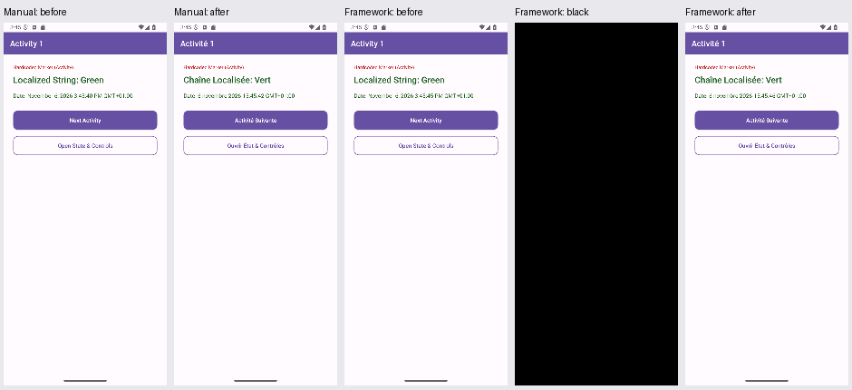

# Sample window recreation findings

2026-11-06. These checks investigate the reported toolbar shift and framework black flash in the original sample, independently of the retired lab.

## Toolbar overlapping the status bar: fixed in the sample

The supplied screenshots showed the existing XML toolbar shifting into the clock/status-bar area. The native sample did not handle system-bar insets. On the API-36 emulator, a regression check failed with toolbar `y=0` and a status-bar inset of 63 px. This was an overlap, not an additional action bar.

`SampleActivity` now explicitly enables edge-to-edge on every creation and pads its XML root using system-bar and display-cutout insets. The toolbar has an explicit contrasting primary color. The regression checks that the toolbar stays below the bars at the same vertical position before/after both recreation paths, and verifies the resulting XML text and activity/toolbar titles use the selected language. It passes on API 36 and, for the available manual path, API 32.

The UI also groups recreation/language controls on the home screen, uses descriptive sample cards and selected-language chips, and keeps the settings sheet usable by scrolling and restoring it across recreation. Native sample buttons and spacing follow the same purple palette as Compose. Diagnostic translated/constant text markers remain available.

## Framework black flash: reproduced, still open

An opt-in instrumentation diagnostic samples the screen while `LocaleManager` changes the language. The final styled XML sample produced these observations on a light-theme API-36 emulator:

| Path | Sampled images | Mostly black samples |
| --- | --- | --- |
| Manual | 9 | 0 |
| Framework | 13 | 2 |

The framework black samples were requested approximately 107 ms and 185 ms after the change. These are screenshot-request timestamps, not display presentation times or a precise blackout-duration measurement. An earlier capture after the inset fix also contained a framework black sample (1 of 14) and none in the manual capture (0 of 14).



Both final activity resource configurations and XML text were French after the change. Manual mode reported `fr`; framework mode reported `fr,en-US`. The black output still occurred with an explicit light `android:windowBackground`, so that background setting is **not a fix** for this flash. The capture establishes the visible failure; it does not establish the responsible WindowManager/SurfaceFlinger operation. No animation, reflection, configuration opt-out, or screenshot-overlay workaround has been added to conceal it or change what the comparison measures.

The next investigation should synchronize a system window/surface trace with a recorded blackout, identify which surface disappears or becomes black, and test a mitigation against both restoration and visual behavior. Physical-device and other API coverage remain necessary. The absence of a black sampled image in manual mode does not prove that arbitrarily short flashes are impossible.

Environment: `Medium_Phone_API_36.0`, Android 16, fingerprint `google/sdk_gphone64_x86_64/emu64xa:16/BE2A.250530.026.D1/13818094:user/release-keys`. Screenshot sampling perturbs timing and is not a benchmark. Images are reduced to 180×400; actual capture cadence is slower than the worker's 20 ms sleep. Raw local captures are under ignored `build/qa/window-captures-polished/`.

## Repeat the visual diagnostic

Build and install both debug app and test APKs, then run:

```powershell
adb -s DEVICE shell am instrument -w -e class com.elianfabian.localeeasy.RecreationWindowCaptureTest -e captureWindows true com.elianfabian.localeeasy.test/androidx.test.runner.AndroidJUnitRunner
```

The diagnostic is skipped in normal regression runs. It writes PNG samples, timing arrays, and final locale/text metadata under the debug app's `files/window-captures/`, accessible through Android Studio Device Explorer. Run directly as above when collecting files: Gradle's connected test task can uninstall fixtures afterward. The diagnostic restores follow-system/framework mode at completion. Use a disposable test installation because this changes the sample's locale preference.

Manual verification remains required for perceived responsiveness, smoothness, status/navigation-bar appearance, dark mode, large text, and the actual affected device.
